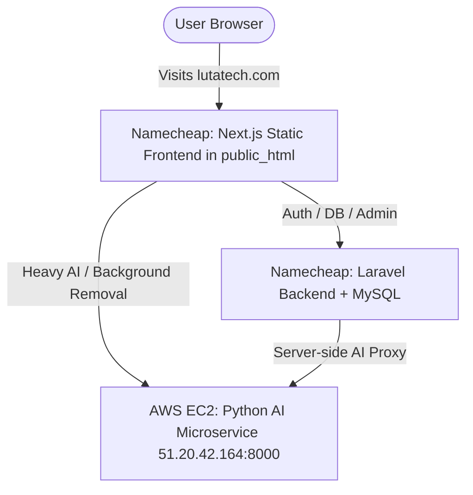

# 🚀 Complete Namecheap cPanel Deployment Guide

This guide walks you through deploying the **Next.js Frontend**, **Laravel Backend**, and **MySQL Database** on Namecheap Shared Hosting, connecting to your live **Python AI Backend on AWS** (`http://51.20.42.164:8000`).

---

## 🏗️ Architecture Overview



---

## 📦 Step 1: Deploy Next.js Frontend to Namecheap

We have created an all-in-one zip file:
📁 **[`frontend-deploy.zip`](file:///Users/timothysanga/Herd/Lutas%203/frontend-deploy.zip)**

1. Log in to your **Namecheap cPanel**.
2. Open **File Manager** and navigate to your domain root (usually **`public_html/`** or **`lutatech.com/`**).
3. Click **"Upload"** in the top menu and select **`frontend-deploy.zip`**.
4. Right-click `frontend-deploy.zip` in File Manager and click **"Extract"**.
5. Delete `frontend-deploy.zip` after extraction.

---

## 🗄️ Step 2: Create MySQL Database on Namecheap

1. In cPanel, go to **"MySQL Database Wizard"** (or *MySQL Databases*).
2. **Step 1: Create Database**: e.g., `youruser_luta`
3. **Step 2: Create Database User**: e.g., `youruser_dbuser` with a strong password.
4. **Step 3: Add User to Database**: Check **"ALL PRIVILEGES"** and click *Make Changes*.

---

## ⚙️ Step 3: Deploy Laravel Backend to Namecheap

1. In cPanel File Manager, create a folder outside `public_html`, e.g.:
   ```text
   /home/yourusername/laravel-backend/
   ```
2. Upload the files from [`laravel-backend/`](file:///Users/timothysanga/Herd/Lutas%203/laravel-backend/) into that folder.
3. In `/home/yourusername/laravel-backend/`, copy `.env.example` to **`.env`** and fill in your database and AWS details:
   ```env
   APP_NAME="Luta Tech API"
   APP_ENV=production
   APP_KEY=base64:your_generated_app_key
   APP_DEBUG=false
   APP_URL=https://lutatech.com

   # Namecheap MySQL
   DB_CONNECTION=mysql
   DB_HOST=127.0.0.1
   DB_PORT=3306
   DB_DATABASE=youruser_luta
   DB_USERNAME=youruser_dbuser
   DB_PASSWORD=your_database_password

   # Live Python AI on AWS
   PYTHON_AI_URL=http://51.20.42.164:8000
   PYTHON_AI_SECRET=luta-tech-secure-jwt-key-2026-production-fallback
   PYTHON_AI_TIMEOUT=60
   ```
4. Run migrations via cPanel Terminal (or SSH):
   ```bash
   cd ~/laravel-backend
   php artisan migrate --force
   ```

---

## 🔒 Step 4: Enable Free SSL & Verification

1. In cPanel, search for **"SSL/TLS Status"**.
2. Select `lutatech.com` and click **"Run AutoSSL"**.
3. Head to **Google Search Console** and check that your `sitemap.xml` shows **🟢 Success**!
