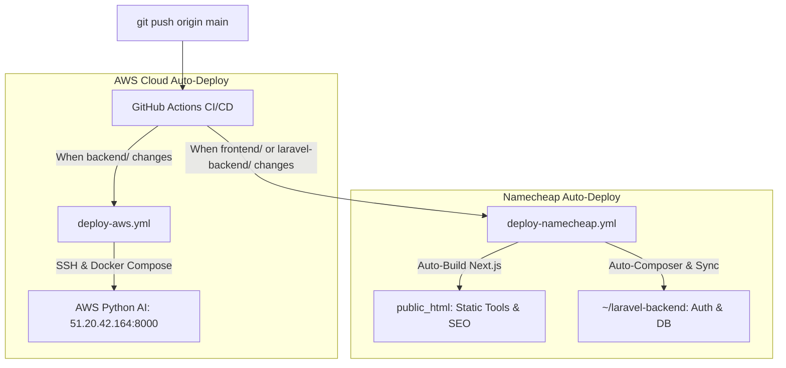

# 🚀 100% Automated GitHub Deployment Guide (Namecheap & AWS)

This guide shows you how to set up **100% automated CI/CD deployment** so that whenever you run `git push origin main`, GitHub automatically deploys:
1. **Next.js Static Frontend** ➔ Namecheap `public_html`
2. **Laravel Backend & Database Migrations** ➔ Namecheap
3. **Python AI Microservice** ➔ AWS EC2 (`51.20.42.164`)

---

## ⚡ How the Automated Pipeline Works



---

## 🔑 One-Time Setup in GitHub (5 Minutes)

You only need to add your credentials to GitHub Secrets once, and everything will be automated forever!

### Step 1: Open GitHub Secrets
Go to your repository settings:
👉 **[github.com/englutandula/lutatech.com/settings/secrets/actions](https://github.com/englutandula/lutatech.com/settings/secrets/actions)**

### Step 2: Add These 3 Secrets for Namecheap:

| Secret Name | What to paste | Where to find it in Namecheap |
| :--- | :--- | :--- |
| **`NAMECHEAP_FTP_SERVER`** | Your Namecheap Hosting IP / Hostname (e.g. `162.0.229.236` or `ftp.lutatech.com`) | In your Namecheap cPanel or Welcome Email |
| **`NAMECHEAP_FTP_USERNAME`** | Your cPanel Username (or FTP user) | In your cPanel dashboard |
| **`NAMECHEAP_FTP_PASSWORD`** | Your cPanel Password (or FTP password) | In your cPanel credentials |

### Step 3: Add AWS Secrets (If not already added):

| Secret Name | Value |
| :--- | :--- |
| **`AWS_EC2_HOST`** | `51.20.42.164` |
| **`AWS_SSH_PRIVATE_KEY`** | Run `pbcopy < ~/.ssh/luta-studio-key.pem` in terminal and paste |

---

## 🚀 How to Deploy in the Future:

Whenever you make any change to the Frontend, Laravel, or Python AI backend, simply run:

```bash
git add .
git commit -m "Update website features"
git push origin main
```

**That's it!** GitHub Actions will automatically build and deploy both to Namecheap and AWS within ~60 seconds with zero manual uploads! 🎉
